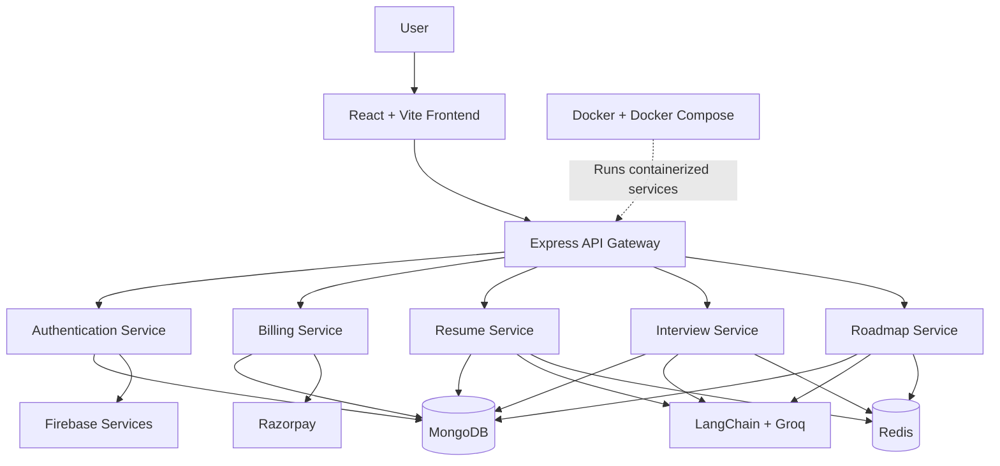

# Elevora — AI-Powered Career Preparation Platform 🚀

**Prepare smarter. Practice confidently. Get career-ready with AI.**

Elevora is an AI-powered career preparation platform designed to help students and job seekers prepare for technical interviews, improve their resumes, and build personalized learning roadmaps. It combines modern web technologies, AI-driven workflows, and a microservices architecture to bring essential career preparation tools into one platform.

From resume analysis to interview practice and skill development, Elevora helps users identify gaps, improve their preparation, and take the next step toward their career goals.

---

## ✨ Features

### 📄 AI Resume Analyzer
- Upload resumes in PDF format.
- Extract resume content for AI-powered analysis.
- Receive ATS-style scores and actionable improvement suggestions.
- Identify missing skills and opportunities to improve resume quality.

### 📝 Resume Builder
- Create and organize professional resumes.
- Prepare resume content for job applications.
- Generate print-ready resume documents.

### 🎯 AI Mock Interviews
- Practice interviews based on your selected technology stack.
- Generate relevant technical interview questions.
- Receive AI-powered feedback and answer evaluations.
- Improve your interview preparation through structured practice.

### 🗺️ Personalized Learning Roadmaps
- Generate learning roadmaps based on your chosen technology stack.
- Identify missing skills and knowledge gaps.
- Get structured recommendations for what to learn next.

### 🔐 Authentication and Account Management
- Support authentication through configured Firebase and email OTP flows.
- Handle authenticated requests using backend authentication and cookie-based mechanisms.
- Protect application resources through server-side verification and authorization.

### 💳 Credit-Based Monetization
- Use a credit-based model for supported AI features.
- Integrate Razorpay for purchasing additional credits.
- Manage payment records and credit allocation through backend services.

### 📊 Interactive User Interface
- Responsive, modern UI built with React and Tailwind CSS.
- Animated interactions and transitions.
- Charts and visual representations for supported analytics.
- Toast notifications and intuitive navigation.

### ⚡ Performance and Scalability
- Redis integration for caching and fast data access.
- Microservices architecture for separating application responsibilities.
- Docker and Docker Compose for containerized development and deployment.

---

## 🛠️ Tech Stack

### Frontend
| Technology | Purpose |
|---|---|
| React 19 | Component-based UI development |
| Vite 8 | Development server and production build |
| JavaScript (ES Modules) | Application logic |
| Tailwind CSS 4 | Responsive UI styling |
| Redux Toolkit | Global state management |
| React Router | Client-side routing |
| Axios | HTTP requests |
| Firebase SDK | Frontend Firebase integration |
| Motion | UI animations |
| Recharts | Data visualization |
| React Icons | Icons |
| Monaco Editor | Embedded code editor |
| React Toastify | Notifications |
| React Circular Progressbar | Circular progress indicators |
| React To Print | Printing React-rendered content |

### Backend
| Technology | Purpose |
|---|---|
| Node.js | JavaScript runtime |
| Express 5 | REST APIs and service endpoints |
| MongoDB | Persistent data storage |
| Mongoose 9 | MongoDB schemas and data modeling |
| Redis | Caching and fast data access |
| ioredis | Redis client for Node.js |
| Firebase Admin SDK | Server-side Firebase operations |
| Axios | Inter-service HTTP communication |
| Nodemailer | Email delivery |
| Multer | File upload handling |
| pdf-parse | PDF text extraction |
| Razorpay | Payment integration |
| dotenv | Environment configuration |

### AI and LLM
| Technology | Purpose |
|---|---|
| LangChain Core | LLM application building blocks |
| LangChain Groq | Integration with Groq-hosted models |
| LangGraph | Graph-based AI workflows |
| Groq API | Language model inference |

### Infrastructure and Development
- Docker
- Docker Compose
- Microservices architecture
- Git and GitHub
- ESLint
- Vite React plugin
- Nodemon

---

## 🏗️ System Architecture

Elevora follows a microservices-based backend architecture. The frontend communicates with a central API gateway, which routes requests to the appropriate backend service.



*The diagram illustrates the intended high-level architecture. Redis usage and service integrations depend on the implemented configuration.*

### Service Responsibilities

| Service | Responsibility |
|---|---|
| API Gateway | Central entry point and request routing |
| Authentication Service | User authentication, account operations and related integrations |
| Billing Service | Payment processing and credit management |
| Resume Service | Resume uploads, PDF extraction and AI-powered resume analysis |
| Interview Service | AI interview question generation and answer evaluation |
| Roadmap Service | Personalized learning roadmaps and skill-gap recommendations |

### Why Microservices?

- **Separation of concerns:** Each service handles a specific business responsibility.
- **Independent development:** Services can be maintained separately.
- **Scalability:** Individual services can be scaled according to their workloads.
- **Maintainability:** Clear service boundaries help organize a growing codebase.
- **Containerization:** Docker provides consistent environments for running services.

---

## 🔄 How It Works

### Resume Analysis
1. The user uploads a PDF resume.
2. The resume service receives the file through an upload endpoint.
3. PDF text is extracted for processing.
4. The AI workflow analyzes the extracted content.
5. Results and suggestions are returned to the frontend and persisted as configured.

### AI Interview Preparation
1. The user selects a technology stack or interview context.
2. The interview service prepares relevant questions.
3. The user submits answers.
4. The AI workflow evaluates the answers and generates feedback.
5. Interview results can be stored for future reference.

### Learning Roadmap Generation
1. The user chooses a target technology stack.
2. The roadmap service processes the selected stack and available skill information.
3. The AI workflow generates a structured learning plan.
4. The roadmap is returned to the frontend for presentation.

### Credit Purchase
1. The user selects an available credit package.
2. The backend creates a payment order.
3. Razorpay handles the payment flow.
4. The backend verifies the payment.
5. Credits are granted after successful verification.

---

## 📁 Project Structure

The application is organized into frontend and backend components, with separate services for major business features.

```text
Elevora/
├── client/                 # React frontend
│   ├── src/
│   │   ├── components/     # Reusable UI components
│   │   ├── pages/          # Application pages
│   │   ├── redux/          # Redux Toolkit state
│   │   ├── routes/         # Routing configuration
│   │   └── ...
│   └── package.json
│
├── services/
│   ├── auth/               # Authentication service
│   ├── billing/            # Payments and credits
│   ├── resume/             # Resume processing and analysis
│   ├── interview/          # AI interview workflows
│   ├── roadmap/            # AI roadmap generation
│   └── gateway/             # API gateway
│
├── docker-compose.yml      # Multi-container configuration
├── .gitignore
└── README.md
```

*This is a representative structure. Adjust the directory names to match the actual repository before publishing.*

---

## ⚙️ Getting Started

Follow these steps to set up Elevora locally.

### Prerequisites

Install the following tools before starting:

- [Node.js](https://nodejs.org/)
- [Git](https://git-scm.com/)
- [Docker Desktop](https://www.docker.com/products/docker-desktop/) with Docker Compose
- A Firebase project if using Firebase authentication
- A Groq API key for AI-powered features
- Razorpay API credentials for payment functionality
- SMTP credentials if email OTP delivery is enabled

MongoDB and Redis can be run through the project's Docker Compose configuration or configured as external services.

### 1. Clone the Repository

```bash
git clone <YOUR_GITHUB_REPOSITORY_URL>
cd Elevora
```

Replace the repository URL with your actual GitHub repository URL.

### 2. Configure Environment Variables

Create the environment files required by the frontend, gateway and individual backend services.

Typical configuration values may include:

| Configuration | Purpose |
|---|---|
| MongoDB connection URI | Connect services to MongoDB |
| Redis connection URI | Connect services to Redis |
| Groq API key | Enable AI model requests |
| Firebase project configuration | Configure Firebase integration |
| Razorpay key ID and secret | Configure payment processing |
| SMTP host and credentials | Enable email delivery |
| Service ports and URLs | Configure service communication |
| Frontend origin | Configure CORS and browser access |

Use the actual variable names defined by each service's code. Check the service configuration and environment-variable references before creating the files.

**Security:** Never commit `.env` files, private API keys, Firebase service-account credentials or payment secrets to GitHub. Provide placeholder values in example environment files instead.

### 3. Start the Application with Docker Compose

If the repository's Compose configuration includes the necessary services and environment settings:

```bash
docker compose up --build
```

To run containers in the background:

```bash
docker compose up --build -d
```

Check the running containers:

```bash
docker compose ps
```

Inspect service logs:

```bash
docker compose logs -f
```

The frontend and API gateway should be accessed using the ports configured in your Compose file. External integrations must also have valid credentials.

### 4. Run Services Individually (Development)

If you prefer to run the services outside Docker, install the dependencies in the appropriate project directories:

```bash
npm install
```

Start the frontend using its configured development script:

```bash
npm run dev
```

For a backend service with a configured development script:

```bash
npm run dev
```

Repeat these commands in the relevant service directories. Ensure MongoDB, Redis, environment variables and any required external services are available.

### 5. Build and Lint the Frontend

From the frontend directory, run:

```bash
npm run build
npm run lint
```

These commands build the production frontend and run the configured lint checks, provided the scripts exist in that package's `package.json`.

---

## 🔑 Environment Configuration

Keep environment configuration separate for each service where appropriate.

For example, a service may need:

```env
NODE_ENV=development
PORT=<SERVICE_PORT>
MONGODB_URI=<MONGODB_CONNECTION_URI>
REDIS_URL=<REDIS_CONNECTION_URI>
GROQ_API_KEY=<YOUR_GROQ_API_KEY>
```

This is an illustrative example, not a complete or guaranteed environment template. Only define variables actually read by the relevant service.

For payment, email and Firebase configuration, use the variable names expected by your implementation. Keep secrets on the server side, and use separate credentials for development and production.

---

## 🔒 Security Considerations

Security is essential for a platform that handles user accounts, resumes, AI requests and payments.

- Store sensitive credentials in environment variables or a secrets manager.
- Validate and sanitize incoming API data.
- Restrict file uploads by type and size.
- Verify Firebase tokens on trusted backend endpoints where applicable.
- Configure secure cookie attributes, including `HttpOnly`, `Secure` in HTTPS environments, and an appropriate `SameSite` policy.
- Configure CORS for trusted origins.
- Rate-limit authentication and expensive AI endpoints.
- Verify payment signatures and trusted payment events on the backend.
- Make payment processing and credit allocation idempotent.
- Avoid logging passwords, tokens, OTPs, private resume contents or payment secrets.
- Use HTTPS in production.

---

## 🚀 Future Improvements

Potential areas for continued development include:

- [ ] CI/CD pipelines for automated testing and deployment.
- [ ] Production monitoring, structured logging and error tracking.
- [ ] Automated tests for critical APIs and payment workflows.
- [ ] Improved AI evaluation and response-quality measurement.
- [ ] More robust caching and database performance optimization.
- [ ] Usage analytics and interview progress tracking.
- [ ] Enhanced accessibility and responsive design.
- [ ] Cloud deployment with reliable service configuration and monitoring.

---

## 🎯 Project Goals

Elevora aims to bring together resume improvement, interview preparation and personalized skill development in one platform.

Its technical goals include:

- Building a modern, responsive full-stack application.
- Integrating LLMs into practical career-preparation workflows.
- Separating backend responsibilities through microservices.
- Supporting payment-based access to AI features.
- Using caching and containerization to improve maintainability and operational flexibility.

---

## 👨‍💻 Author

**Ritesh Barapatre**

MCA Student | Full-Stack Developer | AI Application Development Enthusiast

Interested in building scalable web applications, AI-powered products and cloud-native systems.

### Connect With Me

- GitHub: [Your GitHub Profile](https://github.com/)
- LinkedIn: [Your LinkedIn Profile](https://www.linkedin.com/)

Replace the profile links above with your actual profile URLs.

---

## 📄 License

Add a `LICENSE` file to the repository if you intend to distribute the project under an open-source license. Until a license is selected, all rights remain with the copyright holder.

---

<p align="center">
  <strong>Elevora — Learn. Practice. Improve. Get Career-Ready. 🚀</strong>
</p>
